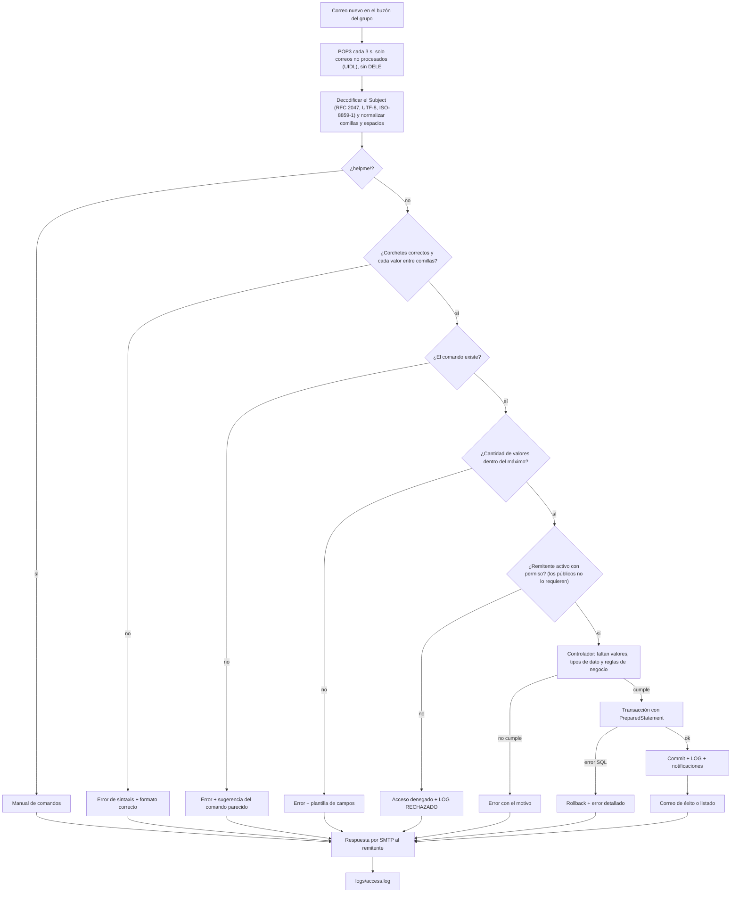

# Sistema de Gestión Académica ICAP por correo electrónico

**INF513 Tecnología Web · Grupo 15 SC · UAGRM**

Backend con arquitectura *Email-Driven*: los usuarios operan el sistema académico del ICAP enviando comandos en el **Asunto** de un correo a `grupo15sc@tecnoweb.org.bo`. El sistema lee el buzón, valida el comando, lo ejecuta en PostgreSQL y responde al remitente con el resultado o con el detalle del error.

- 8 casos de uso y 123 comandos, desde la preinscripción hasta el título con QR
- Java 21 sin dependencias externas salvo el driver JDBC de PostgreSQL: los clientes POP3/SMTP, los PDF, el Excel y el código QR están escritos en el propio proyecto
- Envíe `helpme!` en el asunto para recibir el manual completo de comandos

## Arquitectura

```
[Remitente] --(comando en el Asunto)--> [Servidor de correo tecnoweb.org.bo]
                                                 |
                                       POP3 cada 3 s (MainICAP)
                                                 v
                                    [Parser y validador] --(sintaxis inválida)--> correo de error
                                                 |
                                    [Controlador del caso de uso]
                                                 |
                                   [PostgreSQL db.tecnoweb.org.bo]
                                     |-- error  --> rollback + correo de error detallado
                                     '-- éxito  --> commit + correo de confirmación o listado
```

| Paquete | Responsabilidad | Clases principales |
| --- | --- | --- |
| `src.comunicacion` | Leer el buzón, enviar respuestas y hablar con la pasarela de pago | `ClientePOP3`, `ClienteSMTP`, `LectorMime`, `PasarelaPago`, `PasarelaSimulada` |
| `src.negocio` | Interpretar el comando, permisos y reglas de negocio | `ProcesadorComandos`, un `Ctrl*` por caso de uso, `VerificadorPagos`, `CierreActas`, `AvisoCupoMinimo` |
| `src.persistencia` | Acceso a datos con consultas preparadas | `ConexionBD` y un `*DAO` por tabla |
| `src.modelo` | Entidades del dominio | `Estudiante`, `OfertaAcademica`, `Pago`, … |
| `src.utilidades` | HTML de respuesta, PDF, Excel, QR, archivos adjuntos, validación, configuración y logs | `GeneradorHTML`, `ReportePDF`, `CodigoQR`, `AlmacenDocumentos`, `Configuracion`, `ArchivoLog` |

`MainICAP` es el demonio: revisa el buzón por POP3 con `UIDL`, procesa solo los correos nuevos (los ya atendidos quedan en `correos_procesados.txt`) y **nunca borra correos** del servidor. Un candado (`mainicap.lock`) impide abrir dos instancias en la misma máquina.

### Diagrama de flujo del analizador de correos



## Formato de los comandos

```
COMANDO["valor1", "valor2", ...]
```

- Cada valor va **entre comillas dobles** y se separan con comas; los espacios alrededor no importan.
- Dentro de un valor, una comilla se escribe `\"`: `ADDMOD["SEC-1", "Taller \"Excel\""]`.
- Da igual escribir el comando en mayúsculas o minúsculas. Las comillas curvas de los celulares se aceptan.
- Los comandos sin valores se envían solos: `CATALOGO`, `REPDEM`, `helpme!`.
- No se usan IDs internos: una persona se indica por su CI, una oferta por programa + gestión + grupo, un pago por su número de transacción.

| Caso | Asunto | Respuesta |
| --- | --- | --- |
| Correcto | `LISPER["*"]` | Tabla del personal |
| Correcto | `ADDMOD["SEC-1", "Redaccion Comercial"]` | Éxito: módulo registrado |
| Faltan valores | `ADDMOD["SEC-1"]` | Error + `ADDMOD["codigo", "nombre"]` |
| Sobran valores | `ADDMOD["SEC-1", "x", "y"]` | Error: recibe como máximo 2 valores |
| Sin comillas | `ADDMOD[SEC-1, x]` | Error de sintaxis |
| Comando inexistente | `LISPR["*"]` | Error: ¿Quiso decir LISPER? |
| Tipo de dato | `ADDOFER[..., "2026-02-30", ...]` | Error: fecha no válida |
| Unicidad | `ADDPER["1234567", ...]` con un CI ya registrado | Error: el CI ya está registrado |
| Sin permiso | Cualquier comando desde una cuenta sin el rol | Acceso denegado |

### Casos de uso y comandos

| Caso de uso | Comandos |
| --- | --- |
| CU-01 Gestión de usuarios | `ADDPER LISPER MODPER DELPER RESPER` · `ADDCAP LISCAP MODCAP DELCAP RESCAP` · `ADDEST LISEST MODEST DELEST` · `ASIGROL LISROL QUIROL LISUSR` · `MODCLAVE RESCLAVE` |
| CU-02 Catálogo, mallas y ofertas | `ADDPROG LISPROG MODPROG DELPROG` · `ADDVER LISVER MODVER DELVER APRVER` · `ADDMALLA LISMALLA MODMALLA DELMALLA` · `ADDPRE LISPRE DELPRE` · `ADDMOD LISMOD MODMOD DELMOD` · `ADDOFER LISOFER MODOFER DELOFER APROFER CATALOGO` · `ADDASIG LISASIG MODASIG DELASIG` · `ADDHOR LISHOR MODHOR DELHOR` |
| CU-03 Preinscripción, inscripción y ciclo de vida | `PREINS LISINS MODPRE ANUPRE RESPRE` · `FORMINS ESTINS RESINS` · `INSMOD RETMOD RESMOD KARDEX` |
| CU-04 Aranceles, becas, conciliación de pagos y pasarela | `ADDARAN LISARAN MODARAN DELARAN RESARAN` · `ADDCONV LISCONV MODCONV DELCONV RESCONV ASIGCONV QUICONV` · `ADDPAGO ESTCTA LISPAGO MODPAGO ANUPAGO RESPAGO CONCPAGO OBSPAGO` · `GENPAGO` |
| CU-05 Asistencia, evaluaciones y corrección de notas | `ADDACT LISACT MODACT DELACT` · `ADDSES LISSES MODSES ADDASIS LISASIS MODASIS` · `ADDNOTA LISNOTA MODNOTA` · `VERACTA LISACTA CIEACTA HABREC ENMIENDA LISENM` |
| CU-06 Certificados digitales con QR | `SOLCERT LISELEG GENCERT LISCERT ANUCERT VERCERT` |
| CU-07 Repositorio documental | `ADDDOC LISDOC MODDOC DELDOC BUSDOC` |
| CU-08 Reportes y estadísticas | `REPING REPACAD REPDEM REPNOTAS REPCERT REPLOG` |

Son públicos (sin cuenta) `CATALOGO`, `PREINS`, `SOLCERT`, `VERCERT` y `helpme!`. El resto exige que el correo remitente tenga un rol con ese permiso (`ROL_PERMISO`).

### Actores y roles

| Actor | Cómo se identifica | Qué hace | Permisos |
| --- | --- | --- | --- |
| Director | Usuario con rol Director | Personal y profesores, roles, catálogo, mallas, ofertas, asignaciones, horarios, actas, enmiendas, títulos y reportes | 72 |
| Secretaria | Usuario con rol Secretaria | Estudiantes, preinscripciones, inscripciones, expediente digital, aranceles, convenios, pagos y órdenes de la pasarela | 42 |
| Profesor | Usuario con rol Profesor y perfil académico (`ADDCAP`) | Sesiones, asistencia, actividades y notas de **sus** asignaciones | 15 |
| Estudiante | Correo registrado en su expediente (`ESTUDIANTE.email`); no tiene usuario ni clave | `KARDEX`, `ESTCTA`, `LISDOC` y `LISHOR` de **sus propios** datos y `GENPAGO` para pagar en línea, además de los comandos públicos | 5 |

Un usuario puede tener varios roles (`ASIGROL`). La migración desde los roles anteriores está en `sql/migracion_4_actores.sql`; el permiso de `GENPAGO`, en `sql/pasarela_pago.sql`. Las consultas del estudiante quedan en `access.log`, no en `LOG`, porque `LOG` exige un usuario.

## Base de datos

PostgreSQL 18 en `db.tecnoweb.org.bo`, base `db_grupo15sc`, 33 tablas y 14 índices. El diagrama entidad-relación y el DDL completo están en `DOCUMENTACION PROYECTO EMAIL.docx`.

| Área | Tablas | Contenido |
| --- | --- | --- |
| Seguridad y bitácora | `usuario`, `rol`, `permiso`, `rol_usuario`, `rol_permiso`, `log` | Cuentas por correo, roles, un permiso por comando y la bitácora de acciones por usuario |
| Personal | `personal`, `capacitor` | Personal administrativo y perfil académico de los profesores (capacitadores) |
| Catálogo académico | `programa`, `programa_prerrequisito`, `version_programa`, `modulo`, `modulo_version`, `modulo_version_prerrequisito`, `oferta_academica`, `asignacion_modulo`, `horario` | Programas, versiones de la malla, módulos, ofertas por gestión y grupo, profesor y horario de cada módulo |
| Estudiantes | `estudiante`, `inscripcion`, `inscripcion_modulo`, `historial_estado`, `documento_digital` | Expediente, inscripciones, módulos cursados, cambios de estado con motivo y documentos escaneados |
| Finanzas | `arancel`, `convenio`, `pago` | Aranceles por concepto y gestión, convenios de descuento y pagos con su conciliación |
| Evaluación | `tipo_evaluacion`, `actividad_evaluativa`, `sesion_clase`, `asistencia`, `calificacion`, `acta_calificacion`, `enmienda_nota` | Plan de evaluación, sesiones, asistencia, notas, actas y enmiendas con resolución |
| Certificación | `certificado` | Títulos y certificados con código único y hash del QR |

Ningún registro con estado se borra: los `DEL*` hacen una baja lógica y los `RES*` la revierten.

### Respaldo, vaciado y nueva migración

No hace falta `pg_dump` ni `psql`: las dos herramientas usan el driver JDBC del proyecto y leen `icap.properties`.

| Paso | Comando (desde la carpeta del proyecto) | Qué hace |
| --- | --- | --- |
| Respaldo | `java -cp lib/postgresql-42.7.14.jar deploy/RespaldoBD.java [correos a conservar]` | Solo lee la base y genera `respaldo/AAAA-MM-DD_HHMM/` con cuatro scripts (ver abajo). Por defecto conserva la cuenta `1711167cvr@gmail.com` (Director) |
| Ejecutar un script | `java -cp lib/postgresql-42.7.14.jar deploy/EjecutarSQL.java <archivo.sql>` | Muestra la base y el archivo, y solo ejecuta si se escribe `SI`. También sirve pgAdmin (Query Tool, F5) |
| Vaciar los datos | `sql/vaciar_datos.sql` | Borra todos los registros excepto los roles, los permisos, los tipos de evaluación y las cuentas de su lista. Si un correo de la lista no existe, no borra nada |

Scripts que genera `RespaldoBD`:

- `00_borrar_todo.sql` borra las tablas y sus secuencias.
- `01_esquema.sql` las crea de nuevo, idénticas a la base respaldada.
- `02_datos_base.sql` carga lo mínimo para operar: roles, permisos, `rol_permiso`, `tipo_evaluacion` y las cuentas conservadas.
- `03_datos_completos.sql` carga todas las filas tal como estaban.

Para migrar a una base nueva se ejecutan `01` y `02` y se arranca con `run.bat`. Para volver al estado del respaldo, `00`, `01` y `03`. `respaldo/` no se publica, porque contiene datos personales y claves cifradas. `correos_procesados.txt` no se toca: los correos ya ejecutados siguen marcados.

## Pasarela de pago (CU-04 Flujo E)

El pago en línea es un canal más: el registro de boletas en ventanilla (`ADDPAGO` + `CONCPAGO`) sigue igual. El sistema sigue siendo solo por correo; la pasarela solo cobra.

```
GENPAGO["ci", "concepto"]  -->  orden en la pasarela  -->  respuesta con el QR adjunto (PAGO PENDIENTE, relacion PASARELA)
                                                                   |
                         el estudiante paga desde la app de su banco
                                                                   v
MainICAP, cada pasarela.revision_segundos  -->  VerificadorPagos pregunta a la pasarela por cada orden sin pagar
        pagada        -> CONCILIADO y los mismos avisos que CONCPAGO (estudiante; Secretaría si es la matrícula)
        otro monto    -> OBSERVADO y aviso al estudiante y a Secretaría
        vencida       -> ANULADO y aviso al estudiante
```

- Lo envía el estudiante desde el correo de su expediente (solo para sí mismo) o la Secretaria; en ese caso el QR también le llega al estudiante.
- El monto lo calcula el sistema: arancel vigente menos el convenio. Rigen las reglas de `ADDPAGO` (RN-06 y una sola matrícula por inscripción).
- Pedir otra orden del mismo cobro anula la anterior. Una orden sin pagar no se concilia, observa ni corrige a mano; `ANUPAGO` la anula también en la pasarela.
- La confirmación se obtiene **preguntando a la pasarela**, nunca por un correo del estudiante. La conciliación automática no va a `LOG` porque la hace el sistema, no un usuario.
- No cambia el esquema: usa `PAGO` (`numero_transaccion` = código de la orden, `relacion_depositante` = `PASARELA`).
- **Sin API todavía:** `pasarela.proveedor=simulada` guarda las órdenes en `pasarela_simulada.txt` y el banco se simula con `java -cp bin deploy/SimularPago.java <orden>` (sin argumentos lista las órdenes; con un monto distinto, el pago queda observado; con `vencer`, la orden vence).
- **Con la API del proveedor:** se agrega una clase que implemente `src.comunicacion.PasarelaPago` (crear, consultar y anular una orden; `java.net.http.HttpClient` viene en Java 21) y se pone su nombre en `pasarela.proveedor`. Las claves van en `icap.properties`.

## Documentos adjuntos

Los documentos viajan como **adjuntos del correo** (PDF, JPG o PNG, hasta 10 MB). El sistema guarda el archivo en `documentos/`, y la columna de la tabla guarda su ruta. El esquema no cambia: las columnas siguen siendo texto.

| Documento | Columna | Carpeta | Se carga con | Se consulta con |
| --- | --- | --- | --- | --- |
| Expediente del estudiante (carnet, fotografía, boletas, …) | `documento_digital.url_doc` | `documentos/<ci>/` | `PREINS` (carnet), `ADDPAGO` (boleta), `ADDDOC` / `MODDOC` | `LISDOC`, `BUSDOC` |
| CV del profesor (opcional) | `capacitor.cv_documento` | `documentos/profesores/<ci>/` | `ADDCAP` con el CV adjunto, o `MODCAP["ci", "cv_documento"]` | `LISCAP["ci"]` |
| Programa analítico y propuesta técnica (opcionales) | `asignacion_modulo.programa_analitico` y `.propuesta_tecnica` | `documentos/asignaciones/<programa>_<gestion>_<grupo>_<modulo>/` | `ADDASIG`, cuyos valores 8 y 9 son el **nombre de cada archivo adjunto**, o `MODASIG[..., "modulo", "programa_analitico"]` | `LISASIG[..., "modulo"]` |
| Títulos y certificados emitidos | `certificado` | `documentos/<ci>/<codigo>.pdf` | `GENCERT` | `LISCERT`, `BUSDOC` |

Ejemplos:

```
ADDCAP["5872314", "SC", "Marcelo", "Rojas Suárez", "Calle Ballivián 245", "71234567", "marcelo.rojas.icap@gmail.com", "Licenciado en Gastronomía", "Licenciatura", "8 años como chef ejecutivo"]      + cv_marcelo.pdf
ADDASIG["GAS", "2-2026", "A", "GAS-101", "5872314", "2026-11-23", "2026-12-18", "programa_gas101.pdf", "propuesta_gas101.pdf"]      + esos dos archivos
MODCAP["5872314", "cv_documento"]                                    + el CV nuevo
MODASIG["GAS", "2-2026", "A", "GAS-101", "propuesta_tecnica"]        + el archivo nuevo
```

- Ningún archivo se destruye: el que se reemplaza o se elimina pasa a la carpeta `historico/` de su documento.
- La constancia `PROGRAMA_ANALITICO` (CU-06) exige el archivo del programa analítico y lo envía adjunto junto con el PDF.

## Seguridad

- **Consultas preparadas** en todo el acceso a datos (`PreparedStatement`). Los `MOD*` reciben el nombre del campo en el asunto: se compara contra una lista blanca antes de usarlo en el SQL.
- **Validación de tipos en el servidor** antes del SQL: fechas, horas, enteros, montos, correos y listas cerradas (estados, modalidades, conceptos).
- **Transacción por comando**: cualquier regla incumplida o error SQL deshace todo; las notificaciones solo salen si el comando se confirma.
- **Permisos por rol** según el correo remitente; los intentos rechazados quedan en `LOG`. El estudiante solo puede pedir datos de un expediente con su mismo correo.
- **Credenciales fuera del código**, en `icap.properties`, que no se publica.
- **Adjuntos controlados**: solo PDF, JPG o PNG de hasta 10 MB; el nombre del archivo lo pone el sistema, no el remitente.
- **Correos intactos**: el buzón se lee con `UIDL` y nunca se usa `DELE`; una sola instancia en ejecución (`mainicap.lock`).

## Logs

| Archivo | Contenido |
| --- | --- |
| `logs/access.log` | Una línea por correo procesado: fecha, remitente, asunto, resultado (`OK` o `ERROR: motivo`), qué pasó con la respuesta y duración |
| `logs/error.log` | Excepciones capturadas: errores SQL con su código, fallas de POP3 y SMTP, destinatarios rechazados, errores internos con su traza y el correo que los produjo |
| Tabla `LOG` | Qué hizo cada usuario en cada tabla y cuándo; se consulta con `REPLOG` |

Ejemplo de `access.log`:

```
2026-11-19 10:15:02 | de: 1711167cvr@gmail.com | asunto: LISPER["*"] | resultado: OK | respuesta: entregada al servidor para 1711167cvr@gmail.com | 1412 ms
2026-11-19 10:16:40 | de: otro@gmail.com | asunto: ADDMOD[SEC-1, x] | resultado: ERROR: Sintaxis inválida en ADDMOD: el valor 1 debe ir entre comillas dobles ... | respuesta: entregada al servidor para otro@gmail.com | 380 ms
```

## Tiempo de respuesta

Medido el 2026-11-19 desde una conexión doméstica. La duración de `access.log` va desde que MainICAP toma el correo hasta que el servidor acepta la respuesta.

| Tramo | Tiempo | Depende de |
| --- | --- | --- |
| Gmail entrega el comando al servidor del curso | 18 a 24 s | el servidor de correo (antes de que el sistema vea el correo) |
| MainICAP lo detecta (revisión cada 3 s) | 3 a 6 s | intervalo de revisión y red |
| Ejecución del comando en la base | ~2 s | unas 5 idas y vueltas de ~0,37 s a la base |
| Saludo del servidor SMTP | ~11 s (a veces 1 s) | el servidor de correo |
| Aceptar el destinatario | 5 a 10 s | el servidor de correo |

Lo que hace el sistema para no sumar esperas:

- Abre la conexión SMTP **en cuanto llega el correo**, mientras ejecuta el comando, y la reutiliza para los envíos que siguen (el servidor la cierra tras 20 a 30 s sin uso; el sistema la cierra a los 15 s).
- Envía los **avisos a terceros después de la respuesta** al remitente.
- Si el servidor POP3 no saluda, abandona la revisión a los 10 s y vuelve a intentar.

`java deploy/SondaCorreo.java su_correo@gmail.com` mide estos tramos desde cualquier equipo sin enviar ningún correo.

## Instalación y configuración

### Requisitos

- Java 21 (JDK)
- Acceso a `db.tecnoweb.org.bo:5432` y a `mail.tecnoweb.org.bo` (POP3 110 y SMTP 25)
- `lib/postgresql-42.7.14.jar` (incluido)

### Configuración

Copie `icap.properties.ejemplo` como `icap.properties` y complete las claves de la base y del buzón. Cada valor también puede venir de una variable de entorno (`db.clave` → `ICAP_DB_CLAVE`).

### Windows

```
run.bat
```

Compila en `bin\` y deja el servicio escuchando el buzón (Ctrl+C para detenerlo).

### Linux (VPS)

```bash
sudo apt install openjdk-21-jdk-headless
sudo timedatectl set-timezone America/La_Paz      # opcional: MainICAP ya fija America/La_Paz
sudo useradd -r -m -d /opt/icap icap
# Copiar el proyecto a /opt/icap, junto con icap.properties, documentos/, correos_procesados.txt
# y las fuentes del título en recursos/fuentes/ (ver abajo)
sudo chown -R icap:icap /opt/icap && sudo chmod +x /opt/icap/run.sh
sudo cp /opt/icap/deploy/icap.service /etc/systemd/system/
sudo cp /opt/icap/deploy/logrotate-icap /etc/logrotate.d/icap
sudo systemctl daemon-reload && sudo systemctl enable --now icap
journalctl -u icap -f                              # consola del servicio
```

Antes de activarlo:

- **Una sola instancia**: detenga MainICAP en cualquier otra máquina. Cada una lleva su propio `correos_procesados.txt` y ejecutaría los comandos dos veces.
- **`documentos/`**: la base guarda rutas relativas (`documentos/<ci>/...`, `documentos/profesores/...`, `documentos/asignaciones/...`). Copie la carpeta tal como está.
- **Fuentes del título**: el PDF del título usa `OLDENGL.TTF`, `cambria.ttc`, `cambriab.ttf`, `corbel.ttf`, `corbelb.ttf`, `calibri.ttf` y `OCRAEXT.TTF`. En Windows se leen de `C:\Windows\Fonts`; en Linux cópielas a `recursos/fuentes/`. Sin ellas el título sale en Helvetica.
- **Red**: desde `/opt/icap`, `java deploy/SondaCorreo.java su_correo@gmail.com` mide la base, POP3 y SMTP sin enviar nada, e indica si el servidor acepta reenviar a Gmail desde el VPS.

## Estructura del repositorio

```
MainICAP.java               demonio: lee el buzón, ejecuta y responde
src/comunicacion/           POP3, SMTP y lectura de adjuntos MIME
src/negocio/                ProcesadorComandos y controladores por caso de uso
src/persistencia/           conexión y DAOs
src/modelo/                 entidades
src/utilidades/             HTML, PDF, Excel, QR, validación, configuración y logs
recursos/                   logos del título (y fuentes/, que no se publica)
lib/                        driver JDBC de PostgreSQL
deploy/                     servicio systemd, rotación de logs, sonda de red, simulador de la pasarela,
                            respaldo de la base (RespaldoBD) y ejecutor de scripts SQL (EjecutarSQL)
sql/                        migración a los 4 actores, permiso de GENPAGO y vaciado de datos
documentos/                 archivos adjuntos guardados por el sistema (no se publica)
respaldo/                   respaldos generados por RespaldoBD (no se publica)
icap.properties.ejemplo     modelo de configuración
run.bat / run.sh            compilar y ejecutar en Windows / Linux
```
